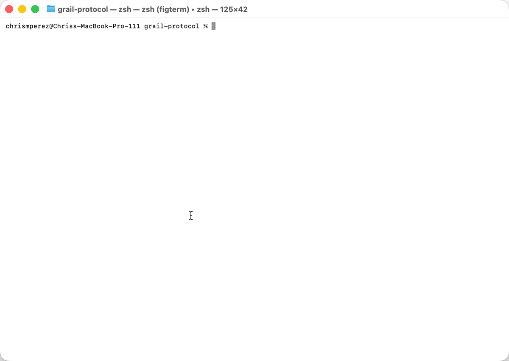
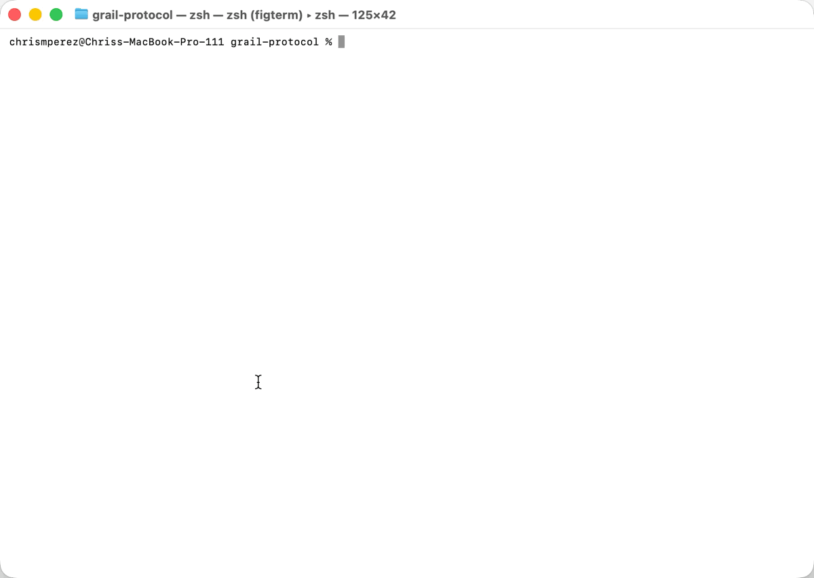

# Grail

A protocol proposal for agents, tools, services, and people to collaborate through graphs, and to carry that work from one product to another.

Declare who can exchange information, which results a step depends on, and what each participant may do. The fabric checks those rules when a message arrives and records accepted messages in a verifiable ledger.

- **Graph routing:** address a participant, a role, or an ability.
- **Dependency gates:** work waits for the required results in its causal history.
- **Delegated authority:** subagents receive tokens that can only narrow their parent's permissions.
- **Traceable results:** inspect declared ancestry and verify ledger hashes.
- **Composable teams:** nested graphs preserve dependency gates and producer identity.
- **Keys by name:** agents reference secrets such as `{"$secret": "github"}`. The fabric reveals a value only in the delivery to the executor allowed to use it, and refuses any message that carries one, so a model can use a key it has never seen.
- **Portable agents:** export an agent's context from one fabric, have its origin attest it, and import it into a fabric run by different software. The history keeps its digests, so the receiver can check it without trusting the sender.

## See it run

All three recordings were made in Terminal on macOS against a locally built fabric. Nothing in them is staged; every answer is the fabric's.

**A team inside one fabric** ([examples/team](examples/team), [MP4](website/template/public/team-demo.mp4)). A review asked for too early is refused by a dependency edge. The writer cannot hand a helper more than it holds. A note sent only to the reviewer is invisible to the writer. Revoking the writer also revokes the helper token it issued, and the verdict's trace and ledger links are checked at the end.



**An agent using a key it never sees** ([examples/secrets](examples/secrets), [MP4](website/template/public/secrets-demo.mp4)). The owner gives a repository key to custody once. The planner learns that it exists and asks the executor to use it by name. Only the executor's delivery holds the value, which it uses against a local service that checks the bearer token. The stored envelope, the ledger, and the trace hold only a reference. An agent cannot be made an audience. Echoing the key, sending it in base64, or sending half of it is refused, and the third attempt revokes the careless executor's token. Every reveal is counted, and rotation and deletion take effect on the very next call.



**An agent moving between two products** ([examples/handoff](examples/handoff), [MP4](website/template/public/handoff-demo.mp4)). Two fabrics with different secrets. A researcher's work is exported from the studio, attested by it, and imported into the desk. There an assistant checks every digest itself and continues the work. One trace covers both fabrics, and a forged handoff is refused.


Run any of them yourself with `python3 examples/<team|secrets|handoff>/demo.py`.

Grail is a draft proposal with a reference fabric written in Pudu. The API runs locally; the [documentation website](https://grail-protocol.chrisperezsantiago1.workers.dev) is hosted on Cloudflare. There is no hosted public API.

## Run locally

Invited testers need access to this private repository. Install [Pudu 0.1.3](https://github.com/chrismichaelps/pudu-lang/releases/tag/v0.1.3), then:

```bash
git clone https://github.com/chrismichaelps/grail-protocol.git
cd grail-protocol
pudu install --locked
mkdir -p build
umask 077
export GRAIL_SECRET="$(openssl rand -hex 32)"
pudu run src/Main.pudu token --scope demo --id root > build/owner.token
pudu run src/Main.pudu serve
```

The server listens on `127.0.0.1:7420`. In another terminal:

```bash
curl http://127.0.0.1:7420/v1/health
curl http://127.0.0.1:7420/.well-known/grail
```

The reference store is in memory. Restarting the server clears its graphs, transfers, handoffs, secrets, and token revocations. Keep the same secret while issuing tokens and running the server.

## Explore

| Start here | What it covers |
| --- | --- |
| [Quick start](website/docs/guides/quick-start.md) | Start the fabric and create your first graph. |
| [Collaboration walkthrough](website/docs/guides/collaboration.md) | Send work, return a result, and enforce a review gate. |
| [Command line](website/docs/guides/command-line.md) | Tokens, operation calls, and the line binding. |
| [Move an agent](website/docs/guides/handoffs.md) | Export, attest, and import an agent's context between fabrics. |
| [Use keys safely](website/docs/guides/secrets.md) | Give keys to custody and let agents use them by name. |
| [Protocol specification](wiki/protocol/_MOC.md) | The model, routing, causality, security, and conformance. |
| [OpenAPI contract](schema/grail.openapi.json) | Every HTTP operation, schema, error, and limit. |
| [Contributing](CONTRIBUTING.md) | Checks, dependency layers, and branch workflow. |

The running fabric serves the contract at [localhost:7420/openapi.json](http://127.0.0.1:7420/openapi.json). Use it with an OpenAPI client or your own integration.

## Development

```bash
pudu test test
pudu run tools/Layers.pudu
pudu run tools/Contract.pudu --check
```

See [Contributing](CONTRIBUTING.md) for the complete validation gate. Report vulnerabilities through the process in [Security](SECURITY.md).

[Apache License 2.0](LICENSE).
