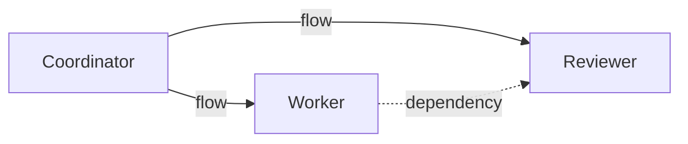

# Graphs and teams

A participant may be an agent, tool, service, memory store, person, or another graph. Participant kinds describe their role; tokens and edges determine permitted interactions.

## Two kinds of edge

| Relation | Meaning |
| --- | --- |
| `flow` | The source may address the target with the allowed envelope kinds. |
| `dependency` | A task at the target requires a result from the source in its causal ancestry. |

Flow edges may form cycles. Dependency edges must be acyclic. A dependency edge does not authorize communication, and a flow edge does not satisfy an ordering requirement.

The coordinator's task to the reviewer must name the worker's result as a parent, directly or through another ancestor. The gate checks admitted result evidence, not the quality or truth of its payload.

## Target a role or ability

A selector names one participant, one role, or one advertised ability. Role and ability selectors reach every matching participant allowed by the source's flow edges. A task with several recipients still has one lifecycle; its first authorized completion wins.

## Treat a team as a participant

A participant of kind `graph` names another graph in the same scope. Delivery expands through that graph's participants with the `entry` role. Entry dependencies and intermediate team dependencies still apply. Every selected branch must resolve, and expansion is bounded.

The fabric retains the task's original route. A valid reply from a terminal recipient can satisfy a dependency on the enclosing team; unrelated internal results cannot. Later entry-role changes do not rewrite the original attribution.

## Change a graph safely

Read its `revision`, then submit a mutation with that `expectedRevision`. A stale mutation is refused with `grail.revision-conflict`; a failing operation leaves the graph unchanged. Removing a participant also removes its incident edges.

The [graph specification](../protocol/06-Graphs.md) defines containment, revisions, and limits.
